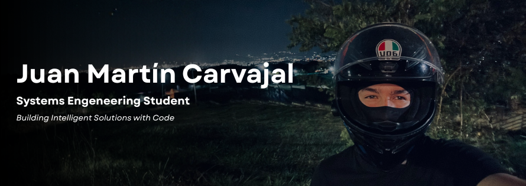
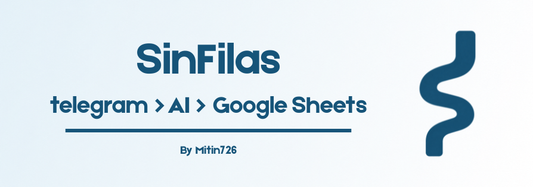

<<<<<<< HEAD
<picture>
  <source media="(prefers-color-scheme: dark)" srcset="assets/banner-dark.svg">
  
</picture>

### Quiubo pues 👋 I'm Juan Martín

Systems Engineering student at Universidad de San Buenaventura (Cali, Colombia), on my way to becoming an **AI Engineer**. I learn by building: small, real tools that solve problems for people around me — using LLMs where they help and plain code where it matters.

[](https://mitin.dev)
[](https://www.linkedin.com/in/mitin726)
[](https://mitin.dev/cv/Juan_Martin_Carvajal_CV_EN.pdf)
[](https://mitin.dev/cv/Juan_Martin_Carvajal_CV_ES.pdf)
[](mailto:jmartincg28@gmail.com)

### Right now

- `building` **AI Engineering**: LLM-powered apps with the Claude API
- `learning` **Backend with FastAPI**: next step on my path to AI Engineer
- `leading` **Group lead at [PADIA](https://lidis.usbcali.edu.co/padia/)**: university research group on ML & data analytics

### Selected work

| Project | Problem → What I built | Stack |
|---|---|---|
| **[SinFilas](https://github.com/Mitin726/sinfilas)** | Checking medicine availability is hard, especially for older adults → Telegram bot in natural language; the LLM only extracts intent as JSON, availability lives in code to avoid hallucinations. Fuzzy matching tolerates typos. | Python · Claude API · RapidFuzz |
| **[Expense Tracker Bot](https://github.com/Mitin726/bot-finanzas)** | Logging expenses by hand gets abandoned → WhatsApp bot that turns free-text messages into Google Sheets rows and answers questions like monthly spend by category. | Node.js · Anthropic API · Sheets API |
| **[Auténtico](https://github.com/Mitin726/autentico-web)** · [live](https://autentico-reposteria.netlify.app/) | A family pastry business needed a site and orders → mobile-first site with a searchable catalog generated from JSON and WhatsApp ordering. | HTML · CSS · JavaScript |

### Stack


---

<sub>Off the keyboard: mountains, motorcycles and my dogs. 🏔️🏍️🐕</sub>
=======
<p align="center">
  
</p>
<!-- BANNER :) -->
<p align="center">
  
</p>

---

## About Me

I am currently a student of **Systems Engineering** and **Multimedia Engineering**.<br>
Passionate about software development, building real-world projects and currently focused in lerning AI.<br>
A **Developer in Progress**, constantly learning and improving my technical skills.
<p align="left">
  
  
  
</p>

---

## Who am I?
 ```python
 class WhoAmI:
 	user = 'Mitin726'
	current_edu = "University of San Buenaventura, Cali"
	hobbies = [
				'Going to the movies',
				'Swiming',
				'Ride my motorcycle B)',
				'Creating projects that help me in my day-to-day life',
				'Chasing my Dreams...'
			]
	
	def getCity():
		return "Cali, Colombia"
	
	def Ambitions():
		LearnAI()
		CreateMyOwnCompany()
		BeHappy() # The Most Important ;)
	
 ```

<h2 align="center">Programming Languages and Technologies</h2>

<div align="center">
  
</div>

## Projects

Here are some of my featured projects :D
<br>

---

<!-- PROJECT 1 -->
## <b> Julia's Fractal Generator Algorithm </b>


<div align="center">
  <a href="https://github.com/Mitin726/Julia-s-Fractal-Generator-Algorithm">
    
  </a>
</div>

<p>
This project focuses on the generation and analysis of Julia fractals using computational algorithms implemented in Python.
Julia fractals are complex mathematical structures that emerge from the iteration of functions in the complex plane. They are characterized by their self-similarity, meaning that smaller portions of the fractal resemble the overall structure.
The main goal of this project is to develop an algorithm capable of generating visual representations of Julia sets and analyzing their behavior based on different parameters.
</p>

---

<!-- PROJECT 2 -->
## <b> SinFilas Bot </b>

<div align="center">
  <a href="https://github.com/Mitin726/sinfilas">
    
  </a>
</div>

<p>
A bot to help people find out if their medications are available before they go to pick them up. (prototype)
</p>

---

<!-- PROJECT 4 -->
## <b> Auténtico Website </b>

<div align="center">
  <a href="https://github.com/Mitin726/autentico-web">
    
  </a>
</div>

<p>
Auténtico is a pastry business founded in Calarcá, Quindío, by my mother, Luz, a professional pastry chef. The website showcases a brand focused on traditional desserts and healthier options, made with high-quality ingredients, dedication, and creativity to offer authentic flavors without compromising on well-being.
In addition to telling the story behind the project, the site lets you explore the product catalog, view the product lines, and place orders directly via WhatsApp. It currently serves Armenia and Calarcá, with personalized service for orders and special celebrations.
</p>

---

## <b> Github Stats </b>
<p align="left"> 

 </p>
<br>

<div align="center">

<br/>

</div>

<div align="center">
<h1>Thanks For Watching :)</h1>

</div>
<p align="center">
     
</p>
>>>>>>> fe23f33fb65284c7d3a1e77da2cb018b639e16bf
